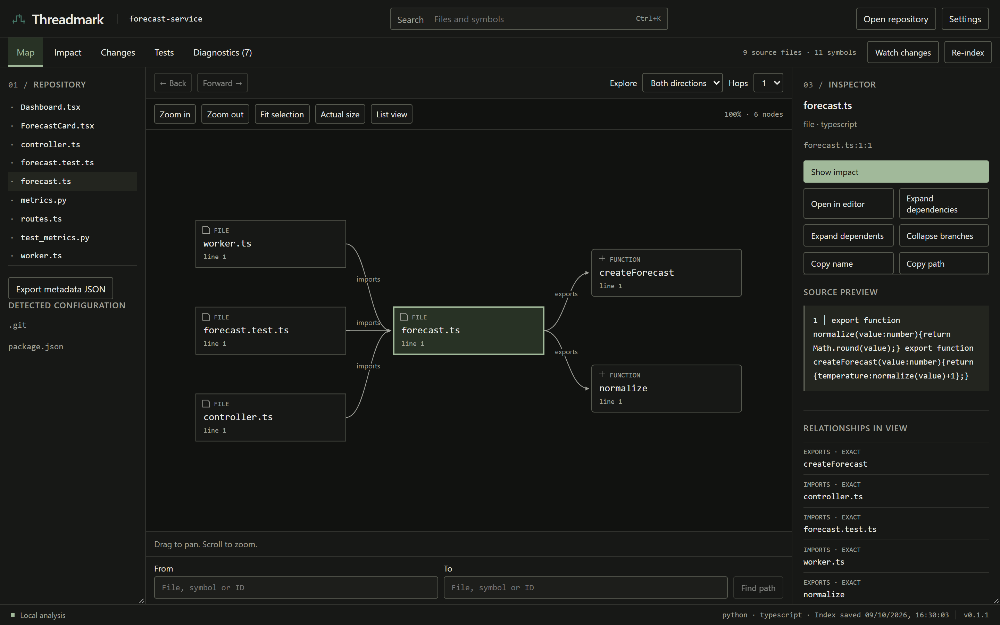

# Threadmark

Threadmark maps relationships inside a codebase: what depends on a symbol,
which code is reachable from a change, and which tests have detected relationships.
The Windows app and CLI share a Rust analysis engine. Everything runs locally;
Threadmark does not upload source code or execute repository scripts.

Version 0.1.1 supports JS/TS and Python indexing, search,
directed neighborhoods, evidence, path tracing, reverse impact, local Git baseline
comparison, test discovery, Express routes, JSX references and optional watching.
See [STATUS.md](STATUS.md) for validation and precise limitations. Static reachability
is not a runtime prediction or a guarantee of test coverage.



[Screenshots](docs/screenshots/README.md) cover the map, source evidence, changes,
impact, tests and diagnostics. See [interface](docs/interface.md) for keyboard
controls and [release notes](docs/release.md) for Windows build details.

## Install on Windows

[Download the Windows 0.1.1 prerelease](https://github.com/Rhythm-Sanghi/Threadmark/releases/tag/v0.1.1).
Choose `Threadmark_0.1.1_x64-setup.exe` for the desktop app, or
`Threadmark-0.1.1-cli-x64.zip` for the portable CLI. The installer runs for the current user. WebView2 must already be installed; the installer
never downloads a runtime. The build is unsigned. The bundled CLI is `threadmark.exe`
in the installation folder; add that folder to PATH yourself if desired. There is
also a portable CLI archive produced by `scripts/package-release.ps1`.
Release assets include source and SHA256 checksums. This is an unsigned early
release candidate; see [known limits](STATUS.md) before relying on its results.
You can also build from source using the steps below.

## First repository

Open Threadmark, choose a local repository and wait for indexing. Search a file or
symbol, focus it, and inspect dependency/dependent edges. Select any relationship
for its source span and evidence. Show impact follows reverse paths. Changes compares
refreshed source with a local Git ref. Tests shows **Detected related tests**.
Configure an installed editor executable in Settings to open relevant source.

```powershell
threadmark index C:\Projects\my-app
threadmark search createForecast
threadmark deps createForecast
threadmark dependents createForecast
threadmark impact createForecast --json
threadmark impact --against main --json
threadmark changes --against HEAD
threadmark tests createForecast
threadmark path ForecastController createForecast
threadmark cycles
threadmark diagnostics
threadmark watch C:\Projects\my-app
threadmark export > graph.json
```

Selectors accept an ID, a path, an unambiguous name, or `path#qualified.name`.
Ambiguous names report candidate selectors. A bounded map deliberately shows one
neighborhood; expand, pan, zoom or refocus to explore. JSON export omits source
snippets by default; CLI `export --include-evidence` explicitly includes them.

## CLI and storage

Options: `--json`, `--quiet`, `--no-color`, `--data-dir PATH`, `--repository PATH`.
JSON envelopes have schema_version 1; watch emits newline-delimited JSON.
JSON and quiet conflict. Exit codes: 0 success, 1 analysis/storage/runtime failure,
2 argument error. Human output is plain text, with terminal control characters
removed. Errors/logs go to stderr. `RUST_LOG=info` enables local diagnostic logging.

The default Windows store is `%LOCALAPPDATA%\Threadmark\Threadmark\data\threadmark.db`;
`status` reports its actual path. It contains settings, graph metadata, evidence
snippets and cached syntax results. It is not encrypted. `.env` values are never
read or stored. `settings --theme system|light|dark` persists appearance. Editor
arguments support `{path}`, `{line}` and `{column}` without a shell:

```powershell
threadmark settings --editor C:\Tools\Code.exe --editor-arg=--goto --editor-arg="{path}:{line}:{column}"
```

## Development and checks

Validated on Windows 11 x64. Install the pinned Rust 1.98.1 toolchain, Node 24.15
or compatible Node, C++ Build Tools, Windows SDK and WebView2. Dependency installation
and installer tool downloads need internet; installed Threadmark works offline.

```powershell
cd apps/desktop
npm ci
npm run tauri dev
npm run lint
npm run typecheck
npm test
npm run build
cd ../..
cargo fmt --all -- --check
cargo clippy --workspace --all-targets --locked -- -D warnings
cargo test --workspace --locked
cargo build --release -p threadmark-cli --locked
cd apps/desktop
npm run tauri build
```

Build the frontend before direct Cargo workspace checks because Tauri embeds dist.
The installer includes the separately built CLI; build it before packaging.
`cargo install --path crates/threadmark-cli --locked` also installs the CLI.
Run `scripts/audit-licenses.ps1` and `scripts/package-release.ps1` from PowerShell
for license inventory and portable/source archives. Source remains GPL-3.0-or-later.
`scripts/generate-notices.ps1` collects dependency license texts before packaging.
Packaged outputs and SHA256 checksums are under `artifacts/release`.

## Scope and evidence

Runtime reflection, computed imports, arbitrary method dispatch, package-based tsconfig
inheritance and dynamic framework behavior can be unresolved. Diagnostics expose
blind spots; partial indexes and bounded results are marked. Syntax-based routes
show declared paths, not proven mounted URLs. Renames appear as added/removed IDs.
No repository scripts, tests, installers, modules, hooks or plugins execute during
indexing. Following external symlinks or junctions is not supported.

Read [architecture](docs/architecture.md), [indexing](docs/indexing.md),
[language support](docs/language-adapters.md), [Python](docs/python.md),
[frameworks](docs/frameworks.md), [impact](docs/impact-analysis.md),
[Git comparison](docs/git-comparison.md), [tests](docs/test-detection.md),
[watching](docs/watching.md), [security](docs/security.md) and
[performance](docs/performance.md). See [LICENSE](LICENSE) and
[dependency licenses](docs/dependencies.md).
